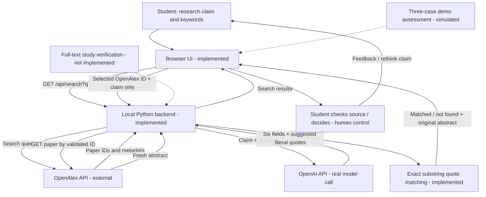

# V0.7 Live-mode data and control flow

`Matched` means literal substring presence in a freshly retrieved OpenAlex abstract only. No full-text or claim-truth verification is performed. Original demo controls and original storyboards are separate from live mode.
