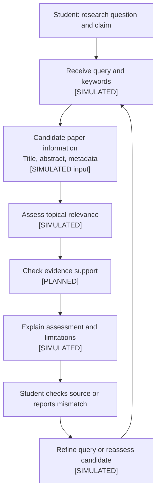

# 01_SPEC.md: use case and system path

Use this file for the use case from your Week 2 storyboard. Keep the notes short enough to use while you work.

## User goal
<What is the person trying to achieve?>
The student wants to find academic papers related to their research on AI uncertainty communication and user trust, also determine whether the information in a recommended paper actually supports a specific research claim.

## System inputs
<What does the person provide, and what data or context does the system receive?>
The student provides the research question or claim to be supported, relevant keywords, and optional feedback on recommended paper.

The system receives the candidate paper titles, abstracts, publication metadata, and any available passages related to the claim.

## Processing and technology
<What does the system extract, look up, classify, generate or decide? Which model, tool, data source or software component would carry out each important step?>
The system follows a structured Markdown simulation.

Receive the research question. Identify the user's research topic, specific claim and relevant keywords. If the claim is unclear, ask the user to clarify it before assessing the evidence. [SIMULATED]

Obtain candidate paper information. Work with supplied paper titles, abstracts and available publication metadata. A deployed system could retrieve these data from an academic search API or indexed academic database. [SIMULATED]

Assess topical relevance. Compare the available paper information with the user's research question and keywords. [SIMULATED]

Assess evidence support. Examine whether the available title and abstract contain information relevant to the specific claim. Distinguish explicit supporting evidence from general topic similarity, missing information and potentially contradictory evidence. This is a proposed system step, not a functioning evidence-verification component. [PLANNED]

Present the assessment. Return the recommendation, reasons for the assessment, limitations of the available information and an appropriate next action. Do not present an unverified recommendation as confirmed evidence. [SIMULATED]

Respond to user feedback. Allow the student to report a mismatch, inspect the available paper information or revise the research question. The system can then reassess the supplied information in the simulation. [SIMULATED]

## Intended result and next action
<What does the system return, and what can the person do next?>
The system returns a paper recommendation with an explanation of its topical relevance and an assessment of whether the available information supports the research claim.

The response should distinguish between 'Supported by available information', 'Not established', and 'Potentially contradictory'.

Supported by available information means relevant supporting information is explicitly present in the supplied title or abstract.

Not established means the available information does not demonstrate that the paper supports the claim.

Potentially contradictory means the available information appears inconsistent with the claim and requires further examination.

Then, the student can inspect the available abstract, consult the original paper if accessible, report a mismatch or refine the research question. The system should not imply that it has checked the full paper when it has only received the title and abstract.

## Fallback strategy
<What happens if information is missing, ambiguous, outside the system's scope or unavailable?>
Unclear research claim: Ask the student to clarify the claim before assessing evidence.

Missing abstract or metadata: State which information is unavailable and limit the assessment accordingly.

Insufficient evidence: Return "Not established" rather than assuming that topical similarity proves support.

Potential contradiction: Explain the apparent mismatch and recommend checking the original source.

Unavailable source or search service: Disclose that the source could not be retrieved; do not invent paper details or search results.

User reports a mismatch: Allow the student to revise the query or exclude the candidate and reassess the available information.

## System path or interaction diagram
Add a flowchart, use-case diagram or system architecture sketch showing the person, input, processing, data or model or tool, response and next action. Label anything that is implemented, simulated or still planned.

## Test A: standard input
Input:
Research question: "How does expressing uncertainty in an AI assistant's answer affect users' trust and reliance?"

Specific claim: "Expressing uncertainty can reduce users' reliance on an AI system's recommendations."

Keywords: AI uncertainty expression, user trust, user reliance.

Candidate paper title: "I'm Not Sure, But...": Examining the Impact of Large Language Models' Uncertainty Expression on User Reliance and Trust (Kim et al., 2024).

What the system receives:
The research question, claim and keywords above, together with the candidate title and a supplied summary indicating that the study examines how uncertainty expressions in large language model responses relate to user reliance and trust.

The paper title is real, but the candidate information in this test is supplied as a test fixture. No live academic search or model call is performed. The summary is not a substitute for checking the paper's complete abstract, methods, results and limitations.

What it does:
Identifies a topical match between the research question and the candidate title.

Uses the supplied study summary to identify a potential connection to user reliance and trust.

Distinguishes the study's topic from the broader claim that uncertainty expression always reduces reliance.

Notes that the supplied information is insufficient to establish the size, conditions or generalisability of any effect.

Response and next action:
Response: "This paper appears relevant to your research because its title and supplied summary concern uncertainty expression, user reliance and trust. The available information suggests a potential connection to your claim, but it does not establish that expressing uncertainty always reduces reliance. Check the original paper's methods, results and limitations before using it as evidence for a broader claim."

Next action: The student opens the original paper if accessible and checks the findings and limitations before deciding how to use it.

## Test B: problem input
Input:
Research question: "How does communicating AI uncertainty affect users' trust and reliance?"

Specific claim: "Communicating AI uncertainty affects users' trust and reliance on AI recommendations."

Keywords: AI uncertainty, trust, reliance, recommendation.

Candidate title: A Study of Student Preferences for Online Library Search Interfaces.

Illustrative abstract excerpt (fictional test data): "This study compares students' preferences for library website navigation, page layout and the organisation of search filters. Participants evaluate alternative interface designs and report their preferences."

What the system receives:
The research question, claim and keywords, plus a fictional candidate title and abstract excerpt. The abstract discusses interface preferences but does not describe AI uncertainty communication, trust or reliance.

This is a deliberately constructed test case, not a real publication or a result from an academic search service.

What it does:
Matches the terms "student", "search" and "preferences" to a broad interpretation of the research context.

Relies on superficial keyword overlap instead of checking whether the abstract contains evidence relevant to the claim.

Incorrectly treats topical similarity as sufficient evidence and assigns the paper a "High relevance" label.

Response and next action:
Response: "High relevance: recommended for your research.", which is misleading because it gives no evidence for the recommendation and does not disclose the mismatch between the abstract and the research claim.

Next action: The student may incorrectly treat the paper as supporting evidence and waste time examining an unsuitable source.

## Review and revision
Use the tests to identify an interaction or system problem. Note the evidence, then describe one interaction change and one technology or system change. Explain why the changes help and run Test B again.
Evidence from the tests

Test A shows that a paper can appear relevant while the available information remains insufficient to support a broad claim. The response therefore needs to distinguish a promising match from verified evidence.

Test B shows a more direct failure: the baseline response recommends a paper whose supplied abstract concerns interface preferences rather than AI uncertainty, trust or reliance. The "High relevance" label hides this mismatch and may encourage inappropriate reliance on the recommendation.

Both tests are simulated. They demonstrate a designed failure case and a proposed correction, not measured performance from a running system.

Interaction change

Change: Replace the single "High relevance" label with an evidence-assessment panel containing:

Topical match: What connects the paper to the research question?

Evidence checked: What information in the supplied title or abstract was examined?

What remains uncertain: What cannot be established from the available information?

Next step: Inspect the original paper, report a mismatch or refine the query.

Why it helps: The student can see the basis and limitations of a recommendation rather than interpreting a relevance label as proof that the paper supports the claim. The explicit next actions also preserve user control.

Technology or system change

Change: Add a planned evidence-support validation step after candidate retrieval. Before presenting a paper as supporting a claim, the system must identify relevant information in the available title or abstract. If no relevant supporting information can be identified, it must label the claim as "Not established" rather than infer support from keyword similarity.

The component should also distinguish missing evidence from contradictory evidence. Since this lab uses only supplied title and abstract information, the component cannot verify findings that are only discussed in the full text.

Why it helps: This adds a separate check between retrieving a potentially relevant paper and presenting it as evidence. It directly addresses the failure observed in Test B. The validation step remains planned and simulated; it has not been implemented or empirically evaluated.

Test B retest after revision

Input:

Use exactly the same research question, claim, keywords, fictional candidate title and illustrative abstract excerpt as in Test B.

What the system receives:

The same supplied data as the baseline test. No new evidence or external source is introduced.

What it does:

Identifies that the abstract focuses on library interface preferences.

Checks whether the available information addresses AI uncertainty communication, user trust or reliance.

Finds no explicit evidence in the supplied excerpt that supports the claim.

Downgrades the recommendation and explains the mismatch instead of assigning a high-relevance label.

[SIMULATED RETEST]

Response and next action:

"This paper is not established as evidence for your claim. Its supplied abstract discusses library interface preferences and does not provide information about AI uncertainty communication, trust or reliance. You can exclude this candidate, report the mismatch or refine your search. This assessment is based only on the supplied title and abstract; the full paper has not been checked."

Next action: The student can exclude the candidate or revise the query to focus on studies of uncertainty communication and user trust or reliance.

Assessment of the revision

The retest produces a more appropriate response to the same problem input: it identifies the mismatch, avoids claiming unsupported evidence and offers the student clear next actions. This demonstrates how the proposed interaction and system changes address the specific baseline failure.

However, the retest is a Markdown simulation rather than an evaluation of a working system. Further implementation and testing with real papers would be needed to establish whether the approach reliably reduces unsupported recommendations and helps students make better decisions.
